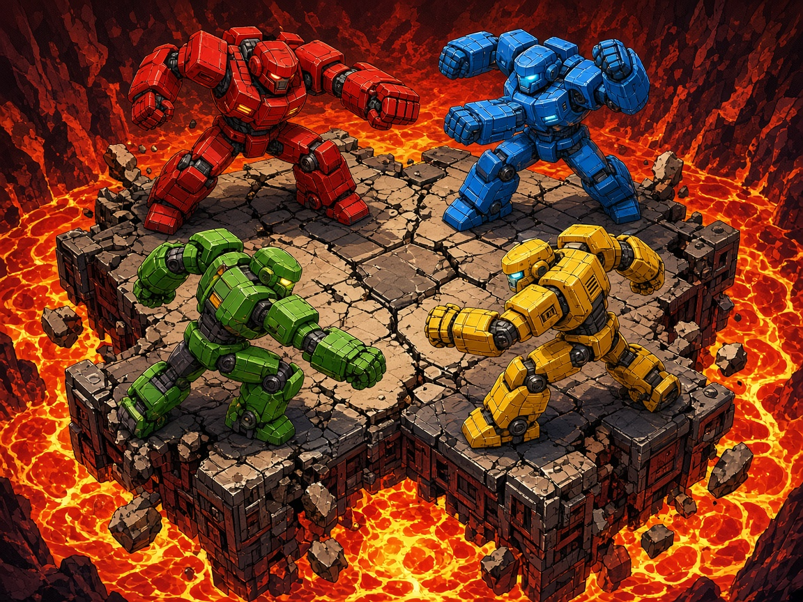

# Mech Pit Brawl

Four mechs, one crumbling slab, a pit of lava. Punch rivals off the stone before the floor drops out from under you. The last chassis with stocks takes the round.

This is a local free-for-all for one to four players on a single screen. Empty slots can be filled by bots, so it is playable solo. It runs in the browser from plain HTML5 canvas and JavaScript, with no build step and no network assets.

## Launch

The game is served on `127.0.0.1`. The default port is **8804** (from `arcade.json`). If that port is busy, the server moves to the next free port and opens the browser itself.

| Platform | One-click launcher |
| --- | --- |
| macOS | Double-click `launch-mac.command` |
| Windows | Double-click `launch-windows.bat` |
| Linux | `./launch-linux.sh` |

From a terminal, in this folder:

```bash
python3 server.py
```

Python 3 is required. The launchers check for it and print a short install hint if it is missing. Everything after that works offline.

## Controls

Keyboard works with no gamepads. Each pilot has a punch (action) and a dash (secondary).

| Pilot | Move | Punch | Dash |
| --- | --- | --- | --- |
| P1 | W A S D | F | G |
| P2 | Arrow keys | / | . |
| P3 | I J K L | ; | ' |
| P4 | Numpad 8 / 4 / 5 / 6 | Numpad 0 | Numpad Enter |

P4 expects Num Lock on, so the numpad keys report as numbers.

| Gamepad | Binding |
| --- | --- |
| Left stick / D-pad | Move |
| A | Punch |
| B | Dash |
| Start | Pause |

Pads 0–3 map to P1–P4. A connected pad overrides that pilot's keyboard and shows a pad icon on the HUD. Pads can be plugged in or unplugged mid-match.

On the join screen, a pilot presses punch (or A) to join. Dash (or B) toggles an empty slot between bot and off. Enter or Start launches the match.

Esc or Start pauses. M mutes. Settings cover volume, how many rounds are in the match, and a controls screen that remaps the keyboard. Bindings and volume are saved in `localStorage`.

## Rules

The stage is a side-view slab of tiles over lava, plus a smaller upper platform. Tiles crack on their own and crack faster while a mech stands on them. When a tile's life runs out it falls into the lava, then eventually rises back into place.

- Punch is a short melee. It adds damage percent and knocks the target back. Knockback grows with the target's damage percent, in the Smash style, so a hurt mech flies farther.
- Dash is a fast horizontal burst. One air dash refreshes on landing. The thruster pickup grants a second.
- Up jumps. Down fast-falls.
- Feet in the lava is a KO. Each mech has 3 stocks. A KO respawns you with zero damage and a short invulnerability window. At zero stocks you are out of the round.
- Last mech standing wins the round. If everyone drops on the same tick, the round is a draw.

### Power-ups

Crates pop onto intact tiles:

- **Coolant** (cyan canister) cuts damage percent.
- **Overclock** (orange bolt) loads the next punch with extra damage and knockback. Charges stack up to three.
- **Thruster** (white chevron) refreshes dash and allows two air dashes.

### Scoring

A round win is one point, shown on the HUD as `R`. The match plays the configured number of rounds (default 3, change it in settings before the next match). Highest round score wins. A tie plays extra sudden-death rounds until one mech is ahead. The results screen lists the standings and offers a rematch.

## arcade.json

`arcade.json` is the cabinet manifest. It names the game, points at `assets/icon.jpg` and `assets/cover.jpg`, lists the one-click launchers plus `index.html`, and declares 4 players, keyboard and gamepad input, version `1.0.0`, and port `8804`. `server.py` reads that port when it starts.

## Tests

Core rules live in `src/core/` with no DOM, so they run headlessly. Rendering, input devices, and audio live in `src/ui/`.

```bash
node --test tests/
python3 tests/smoke_server.py
```

The node suite covers movement and collision, punch knockback, stocks and elimination, round and match wins, power-ups, seeded RNG, keyboard and mocked gamepad mapping, and that `arcade.json` points at files that exist. The Python smoke test starts `server.py` without a browser and checks that it serves `index.html`. GitHub Actions runs both.

## License

[MIT](LICENSE).
